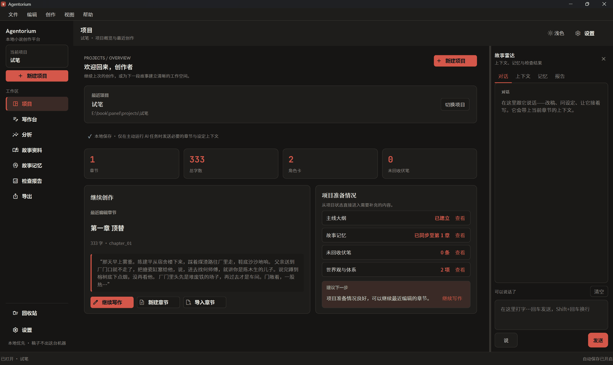
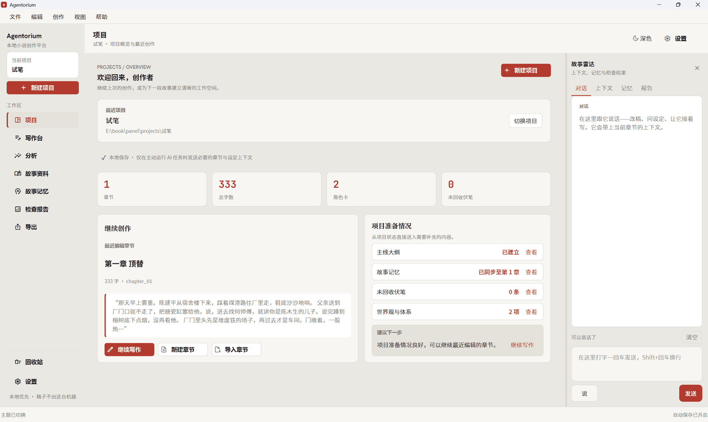
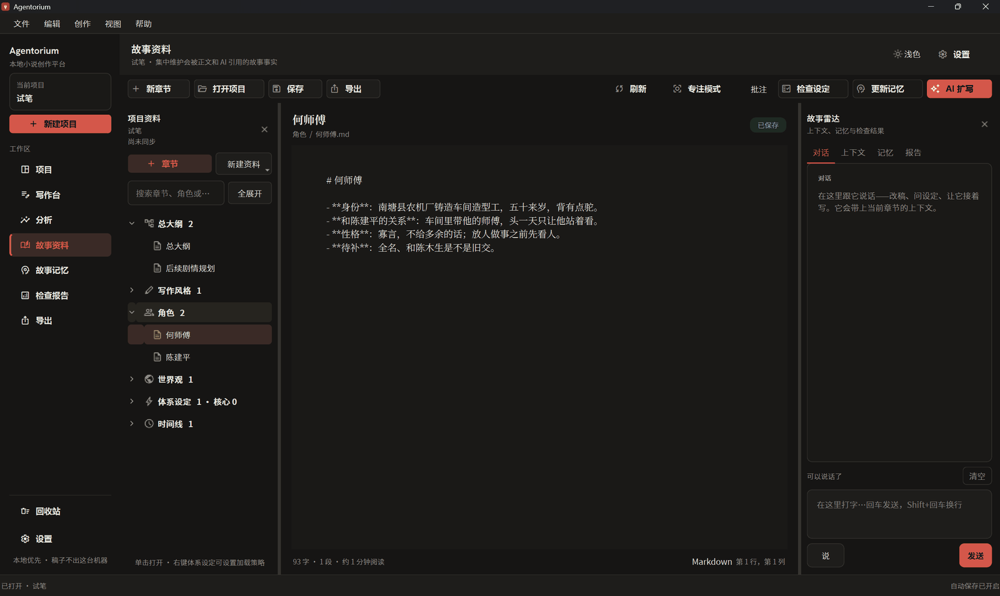
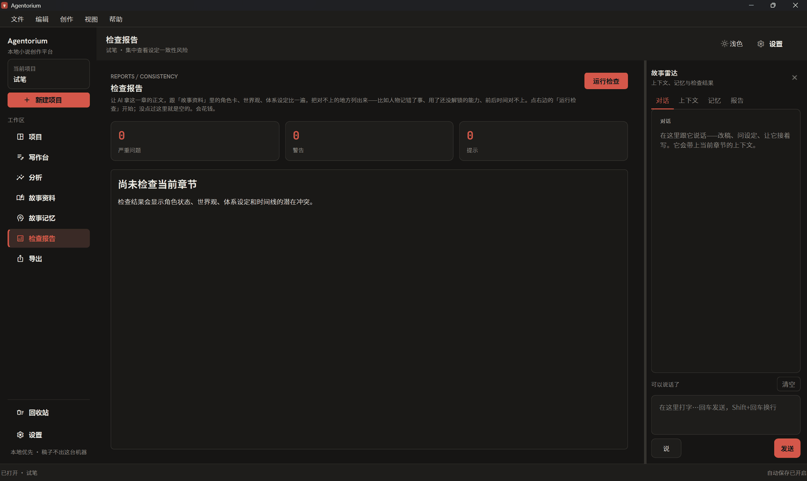
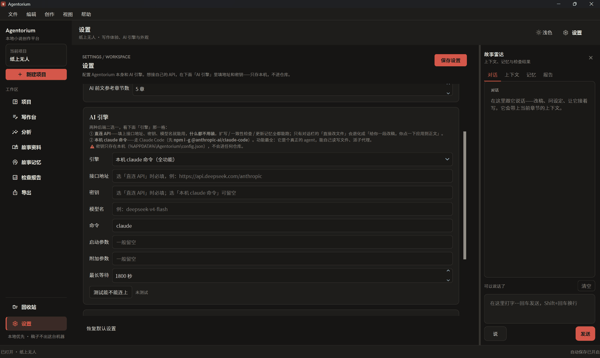

# Agentorium

> **A multi-agent production line that puts AI to work—with the right checks in place.**
>
> A persistent Writer agent produces drafts; independent readers, who see only the manuscript, and a Logic Reviewer, who has access to the full canon, check the work from different perspectives. **Information boundaries, cross-checking, and verifiable evidence** help keep long-running work consistent.

**The project has two parts. The production line is the core; the desktop workspace supports it.**

| | What it is | Where it runs |
|---|---|---|
| ⭐ **Production line** | A Writer agent with persistent memory produces drafts over time. Separate sessions act as readers and reviewers, checking one another's work through information boundaries and cross-verification. **This is the core.** | **In the terminal**, across agent sessions. See [`DESIGN.md`](DESIGN.md) for the workflow. |
| **Workspace** | A shared desk for people and agents. Manuscripts, canon, outlines, memory, foreshadowing, and summaries live in project files. Authors use the workspace to inspect progress and structure, or to start an AI task. | **This repository**: the desktop application. |

**In short: agents read and write through the workspace; people use it to review the work.** Agentorium is not a one-click system that automatically writes an entire novel. It is the desktop workspace for a carefully managed production line.

To use your own API provider, enter its endpoint, API key, and model in Settings. Any Anthropic-compatible endpoint can be used.

## Documentation

| Document | What it covers |
|---|---|
| **`README.md`** (this file) | What Agentorium does · installation · connecting an AI backend |
| ⭐ **[`FILES.md`](FILES.md)** | File map: where to start · where the workflow is implemented · what each directory contains |
| ⭐ **[`DESIGN.md`](DESIGN.md)** | How the process works: roles, information boundaries, review rounds, evidence and error tracking, and replaceable tools |
| **[`NOTICE.md`](NOTICE.md)** | Upstream attribution and project notices |
| [`PRIVACY.md`](PRIVACY.md) | Where data is sent · where API keys are stored |
| [`PACKAGING.md`](PACKAGING.md) | Packaging the application as an executable |

---

## Demo

**Project overview** — the left side shows the story structure, the center shows progress and recent work, and the right side keeps AI conversation at hand. Both dark and light themes are available.

| Dark theme | Light theme |
|---|---|
|  |  |

**Story canon** — character sheets, worldbuilding, system rules, and timelines are organized in the navigation tree and edited in place. These are the project facts supplied as context to AI tasks, rather than facts the model is expected to invent.



**Consistency report** — compare a chapter with character sheets, world rules, and systems, and surface potential conflicts such as a character misremembering an event, using an unavailable ability, or contradicting the timeline.



**Settings → AI Engine** — choose between a direct API connection (configure three fields; no extra CLI installation required) and the local `claude` command (full agent capabilities). API keys are stored locally and are not included in the repository.



---

## 1. The Problem

Getting AI to write one chapter is not difficult. **Keeping it on track for a hundred chapters is.** Long-form writing with AI tends to run into three problems:

| Problem | What happens |
|---|---|
| **Continuity drift** | By chapter 60, the model has forgotten a plot thread introduced in chapter 12. |
| **Self-review bias** | The same model writes and reviews its own work, concludes that it looks fine, and misses its own mistakes. |
| **Unverifiable claims** | The agent says it checked something, but the author cannot tell whether it actually did. |

Agentorium's design addresses these three problems.

## 2. Four Roles, One Review Gate

```text
                      ┌──────────────────────────────┐
                      │  Workspace (this repository) │
                      │  One shared project record   │
                      └──────────────┬───────────────┘
                                     │ same files · scoped context
        ┌────────────────────────────┼────────────────────────────┐
        │                            │                            │
   ┌────▼─────┐               ┌──────▼──────┐              ┌──────▼──────┐
   │  Writer  │               │ Cold Reader │              │ Logic       │
   │          │               │             │              │ Reviewer    │
   │ drafts   │               │ manuscript  │              │ full canon  │
   │ chapters │               │ only        │              │ + outline   │
   └────┬─────┘               └──────┬──────┘              └──────┬──────┘
        │ draft                      │ reader response             │ conflicts
        └──────────────┬─────────────┴────────────────────────────┘
                       ▼
              ┌──────────────────┐
              │ Human author     │  cross-check → decide → revise → review
              └──────────────────┘
```

The information-boundary matrix is the heart of the process:

| Role | Manuscript | Canon / outline | Prior memory | Other reviewers' feedback |
|---|:---:|:---:|:---:|:---:|
| **Writer** | ✅ | ✅ | ✅ | — |
| **Cold Reader** | ✅ | ❌ | ❌ | ❌ |
| **Permanent Reader** | ✅ (new chapters only) | ❌ | Its own notes | ❌ |
| **Logic Reviewer** | ✅ | ✅ | ✅ | ⛔ Withheld until its independent review is complete |

**Two essential review gates:**

1. ⛔ **Do not give reader feedback to the Logic Reviewer before its independent review.** It has the full canon and is the specialist for continuity. Giving it other reviewers' answers first can bias its findings and makes it impossible to tell what it would have caught on its own.
2. ⛔ **Keep a genuinely cold-read perspective in the process.** A Permanent Reader that has read many rounds may become accustomed to confusing passages. Only a new reader can show whether someone encountering the story for the first time can follow it.

## 3. Four Practices Proven in Use

| Practice | What it means |
|---|---|
| **Trust reader diagnoses; judge prescriptions yourself** | Take seriously where readers struggle, but decide independently how to address it. Cross-check proposed changes with other readers first; majority taste alone is not a reliable guide. |
| **Make evidence verifiable** | Each agent records which source it used, the exact passage, and where it applied. Scripts can check whether cited material exists and matches. |
| **Track recurring errors** | Record how often the same class of mistake occurs and where prevention belongs. One warning is easy to forget; a visible history is actionable. |
| **Collect, decide, and revise in batches** | Gather the findings first, judge them together, and give the Writer one complete revision brief instead of discovering and fixing issues one at a time. |

These practices are not just theory. They were refined through dozens of rounds on a real long-form novel project.

## 4. Run the Application

### 1. Install Python dependencies

```bash
pip install -r requirements.txt
```

### 2. Start Agentorium

```bash
python main.py
```

On Windows, you can also double-click `run.bat`. To package an executable, see [`PACKAGING.md`](PACKAGING.md).

> ⚠️ If `python` on Windows opens the Microsoft Store or does not start, the Windows **App Execution Alias** may be taking precedence. This does not necessarily mean Python is missing. Try `py main.py`, or double-click `run.bat`; the launcher tries `python` and then `py`.
>
> To connect AI, see [Section 6](#6-connect-an-ai-backend). Choose either a direct API connection (endpoint and key; no additional CLI installation) or the local `claude` command (full agent capabilities).

## 5. First Use: From a New Project to a Chapter

1. **Create a project:** select **New** in the left sidebar, enter a name, and choose an empty directory.
2. **Write a chapter:** select **Chapters / Chapter 1** on the left and write in the editor.
3. **Ask AI for help:** enter a request in the **Conversation** panel, such as “Make this chapter's opening more restrained.” Review the proposed text, then select **Apply to manuscript** to insert it.
4. **Update memory:** after writing, select **Update memory**. Chapter summaries, foreshadowing, and character state are saved under `memory/` and can be supplied to later writing tasks.
5. **Review structure and export:** the **Analysis** page contains tables, a relationship graph, and a story-flow diagram. The **Export** page can export the manuscript as Markdown or plain text.

> ⚠️ AI tasks may take time because they read and write project files. To understand what happens during a task, see [`DESIGN.md`](DESIGN.md).

## 6. Connect an AI Backend

Open **Settings → AI Engine** and choose an engine.

### Option A · Direct API

Choose **Direct API** and enter the endpoint, API key, and model:

| Field | Example |
|---|---|
| **Endpoint** | DeepSeek: `https://api.deepseek.com/anthropic` · Anthropic: `https://api.anthropic.com` |
| **API key** | Your provider API key |
| **Model** | For example, `deepseek-v4-flash` |

Select **Save settings**, then **Test connection**.

This option supports AI expansion, consistency checks, memory updates, and suggested revisions. Suggested text still requires your approval via **Apply to manuscript**. Direct API mode does not provide tool use, so it cannot perform the conversation panel's direct file-editing workflow; instead, it returns proposed text for you to apply.

### Option B · Local `claude` command

Choose **Local `claude` command**. It uses [Claude Code](https://claude.com/claude-code):

```bash
npm install --global @anthropic-ai/claude-code
```

⚠️ **An Anthropic account or subscription is not inherently required by the CLI setting itself.** The endpoint, model, and credentials depend on the configured environment and the three API fields above; if those fields are empty, the CLI uses its own sign-in.

This option provides full agent capabilities, including reading and writing project files and delegating subtasks. The conversation panel's direct file-editing workflow uses this backend.

### Both options

- ✅ The API key is stored in the local `%APPDATA%/Agentorium/config.json` configuration and is not included in the repository.
- ✅ Both options can connect to providers that expose an Anthropic-compatible API.
- ✅ When API settings are supplied to the CLI, they apply only to the subprocess started by Agentorium; they do not modify the system environment.

**Troubleshooting connection issues:**

1. For the CLI option, run `claude --version` in a terminal to check whether the CLI is installed and available.
2. Select **Test connection** in Agentorium to display the actual error beside the button.
3. `401` or `403` usually indicates an invalid key or insufficient quota. `404` often indicates an incorrect endpoint; some providers require the `/anthropic` suffix.
4. If the model is not found, check the exact model name in your provider's console.

## 7. Project Structure

```text
main.py                 Application entry point
core/                   Configuration, projects, prompts, memory, foreshadowing, and AI backends
ui/                     Workspace, navigation, tables, story-flow and relationship views, conversation, and settings
assets/                 Icons and fonts
licenses/               Third-party license texts
tests/                  Unit tests
projects/               Example and user projects, one directory per project
```

Each novel project is a directory containing `outline/` (outlines and chapters), `canon/` (facts, characters, and worldbuilding), `memory/` (summaries, foreshadowing, and story state), and `writing/` (style guide and reference routing).

For a file-by-file explanation, including where the workflow logic lives, see [`FILES.md`](FILES.md).

## 8. Upstream and License

This project is based on [xiauho/novalist](https://github.com/xiauho/novalist) and is distributed under the MIT License. The upstream writing-workspace framework and UI are derived from Novalist; its copyright notice is retained in [`LICENSE`](LICENSE) as required by the license.

Agentorium's additions include:

- **Replaceable AI backends:** the upstream project used `dsh` (DeepSeek Harness); Agentorium uses a local `claude` command and adds endpoint, key, and model settings for Anthropic-compatible providers.
- **Multi-agent collaboration:** Writer, reader, and logic-review roles with information boundaries, cross-checking, verifiable evidence, and recurring-error tracking.
- **Reusable workflow practices:** the four practices described in Section 3 and the rules for deciding which role can see which information.
- A redesigned interface and fixes for long-form writing workflows.

For third-party dependency licenses, see [`THIRD_PARTY_NOTICES.md`](THIRD_PARTY_NOTICES.md) and [`licenses/`](licenses/).
